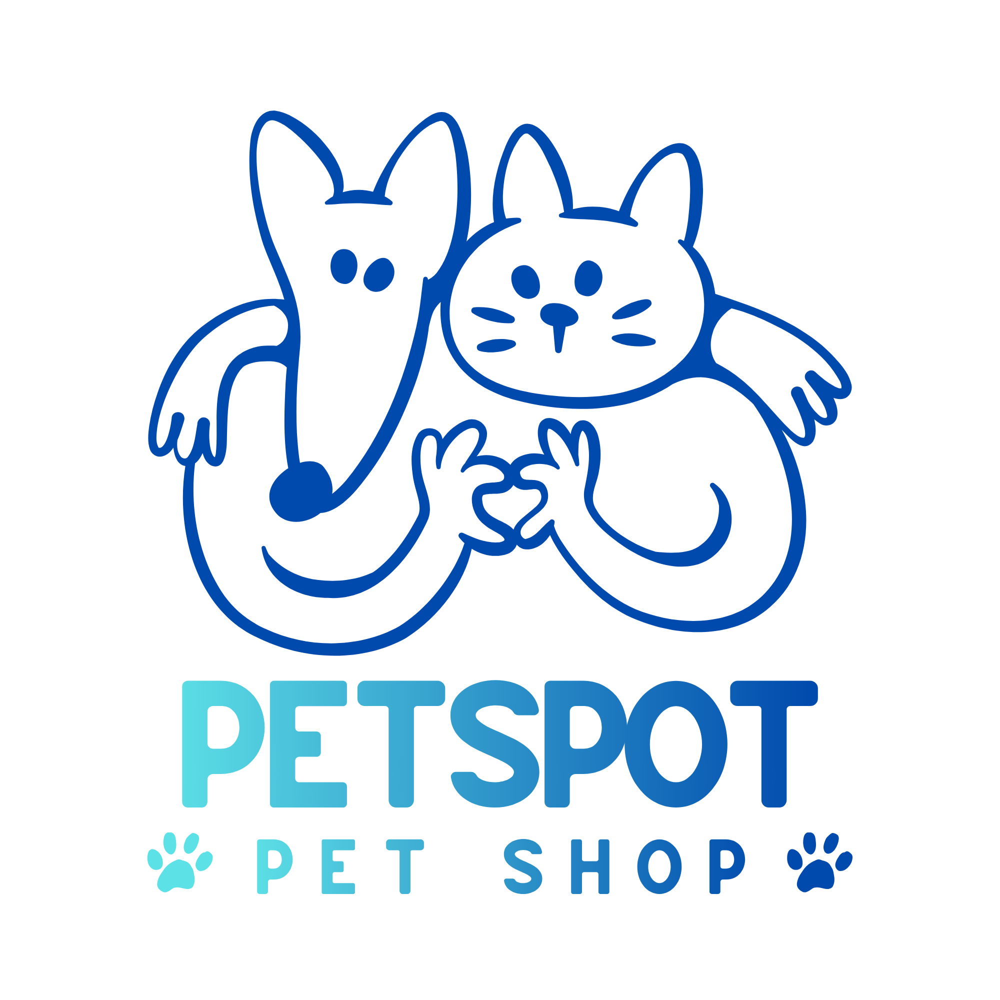

# 🐾 PetSpot — Landing Page para Pet Shop



A **PetSpot** é uma landing page de apresentação de uma marca de alimentação e produtos para cães. O projeto foi desenvolvido com **HTML5, CSS3 e JavaScript puro**, com foco em apresentar a proposta da marca, destacar seus produtos, transmitir confiança e incentivar o visitante a conhecer os planos oferecidos.

A página utiliza uma identidade visual amigável e moderna, conteúdo em português e um layout responsivo para diferentes tamanhos de tela.

## 🎯 Objetivo do projeto

Construir uma página institucional e comercial para um negócio do segmento pet, reunindo informações para apresentar a marca e incentivar a interação do visitante.

- Apresentar a proposta de alimentação preparada para cães.
- Destacar benefícios e diferenciais da marca.
- Exibir categorias de produtos.
- Apresentar depoimentos e elementos de credibilidade.
- Responder às dúvidas mais comuns.
- Disponibilizar formulário visual de newsletter.
- Utilizar chamadas para ação (Call to Action).

> **Observação:** o projeto contém a interface front-end. Não possui integração implementada com banco de dados, pagamentos, autenticação, carrinho de compras ou serviço de newsletter.

## ✨ Funcionalidades

### 1. Cabeçalho e navegação
- Cabeçalho fixo no topo.
- Banner promocional.
- Logotipo PetSpot.
- Menu de navegação.
- Menu mobile com botão hambúrguer.
- Alternância entre abrir e fechar o menu.
- Menu horizontal em telas acima de 900 px.

### 2. Seção principal (Hero)
- Apresentação da proposta da marca.
- Imagem de destaque.
- Texto promocional.
- Botão para iniciar a criação de um plano.

### 3. Seção de credibilidade
- Exibição de logotipos e imagens de referências utilizadas no layout.
- Grade responsiva com duas ou quatro colunas.

### 4. Benefícios e diferenciais
- Apresentação dos benefícios propostos pela marca.
- Blocos com imagens e textos.
- Destaque para receitas com ingredientes reais.
- Apresentação do processo de personalização, preparação e entrega.

### 5. Vitrine de produtos

A página apresenta quatro categorias:

- **Comida cozinhada:** refeições preparadas com foco em sabor, textura e preservação de nutrientes.
- **Comida assada:** opções assadas lentamente.
- **Acessórios:** categoria de produtos para animais.
- **Petiscos:** opções de agrados para os cães.

Os produtos são exibidos em cards com imagens, títulos e descrições.

### 6. Depoimentos dinâmicos
- Exibição de depoimentos.
- Alternância automática entre os textos.
- Navegação manual pelo clique nos logotipos.
- Destaque visual do depoimento selecionado.
- Troca automática a cada três segundos.

### 7. Perguntas frequentes (FAQ)
- Lista de perguntas e respostas.
- Sistema de acordeão.
- Abertura e fechamento das respostas.
- Exibição de apenas uma resposta por vez.
- Animação de abertura e fechamento.

### 8. Newsletter
- Campo para digitação de e-mail.
- Botão de envio.
- Layout responsivo.

**Importante:** o formulário está presente apenas na interface. Não existe integração com API ou serviço responsável por armazenar ou enviar os e-mails.

### 9. Rodapé
- Links organizados por categorias.
- Produtos, Sobre, Comunidade e Suporte.
- Informações ilustrativas de contato e redes sociais.
- Barra inferior com direitos reservados.

## 🧰 Tecnologias utilizadas

| Tecnologia | Aplicação |
|---|---|
| HTML5 | Estrutura e organização do conteúdo. |
| CSS3 | Estilização e responsividade. |
| JavaScript | Interações e funcionalidades dinâmicas. |
| Google Fonts | Fontes Lato e Grandstander. |
| SVG, PNG e JPG | Recursos gráficos e imagens. |

O projeto não utiliza frameworks ou bibliotecas JavaScript externas.

## 📁 Estrutura do projeto

```text
landingpage-petshop/
│
├── index.html
├── README.md
│
└── assets/
    ├── css/
    │   ├── base.css
    │   ├── header.css
    │   ├── hero.css
    │   ├── seen.css
    │   ├── topics.css
    │   ├── products.css
    │   ├── testimonials.css
    │   ├── faq.css
    │   ├── newsletter.css
    │   └── footer.css
    │
    ├── images/
    │   ├── logo.png
    │   ├── hero.png
    │   ├── hero-center.png
    │   ├── comida-1.png
    │   ├── comida-2.png
    │   ├── comida-3.png
    │   ├── comida-4.png
    │   ├── t1.jpg
    │   ├── t2.jpg
    │   ├── t3.jpg
    │   ├── arrow.svg
    │   ├── cbs.svg
    │   ├── forbes.svg
    │   ├── fox.svg
    │   └── sharktank.svg
    │
    └── js/
        └── script.js
```

## 📋 Responsabilidade dos arquivos CSS

| Arquivo | Responsabilidade |
|---|---|
| `base.css` | Reset, variáveis de cores, fontes e estilos globais. |
| `header.css` | Cabeçalho, banner e navegação. |
| `hero.css` | Seção principal e imagens de destaque. |
| `seen.css` | Logotipos de credibilidade. |
| `topics.css` | Benefícios e diferenciais. |
| `products.css` | Cards e vitrine de produtos. |
| `testimonials.css` | Estilização dos depoimentos. |
| `faq.css` | Perguntas frequentes. |
| `newsletter.css` | Formulário de newsletter. |
| `footer.css` | Rodapé e links. |

O arquivo `assets/js/script.js` concentra as interações JavaScript.

## ⚙️ Funcionamento do JavaScript

O arquivo `assets/js/script.js` implementa três funcionalidades principais:

**Menu responsivo**
- Identifica o botão do menu e a navegação.
- Alterna a classe `opened`.
- Controla os ícones de abrir e fechar.

**Depoimentos**
- Armazena os depoimentos em uma lista de objetos.
- Cria os elementos de imagem dinamicamente.
- Permite selecionar depoimentos manualmente.
- Realiza alternância automática utilizando temporizadores.

**FAQ**
- Identifica os itens da seção de perguntas.
- Adiciona eventos de clique.
- Controla a classe `opened` para exibir ou ocultar respostas.

## 📱 Responsividade

O projeto utiliza media queries para adaptar o layout aos diferentes dispositivos.

| Largura | Comportamento |
|---|---|
| Até 600 px | Layout em coluna e menu mobile. |
| Acima de 600 px | Vitrine com duas colunas e rodapé com duas colunas. |
| Acima de 900 px | Menu horizontal, vitrine com quatro colunas e rodapé com quatro colunas. |

## 🚀 Como executar o projeto

O projeto não exige instalação de dependências.

1. Clone o repositório.
2. Abra a pasta no Visual Studio Code.
3. Execute o arquivo `index.html` no navegador ou utilize a extensão Live Server.

### Clonar o repositório

```bash
git clone https://github.com/VictorGang8/landingpage-petshop.git

cd landingpage-petshop
```

## 🔧 Melhorias futuras

- Integração da newsletter com uma API.
- Implementação de cadastro e login.
- Criação de carrinho de compras.
- Integração com gateway de pagamento.
- Implementação de páginas individuais de produtos.
- Integração de avaliações reais de clientes.
- Melhorias de acessibilidade.
- Validação de formulários.
- Implementação de links funcionais para as seções e serviços.

## 👨‍💻 Autor

**Victor Gabriel Tavares Oliveira**

- GitHub: [@VictorGang8](https://github.com/VictorGang8)
- Repositório: [landingpage-petshop](https://github.com/VictorGang8/landingpage-petshop)

## 📄 Licença

Este repositório não possui uma licença explícita definida no momento. Consulte o autor antes de reutilizar ou distribuir o código.

---

<p align="center">
  Desenvolvido como projeto de estudo e prática de desenvolvimento front-end.
  <br>
  🐾 PetSpot — Cuidado e alimentação para quem faz parte da família.
</p>